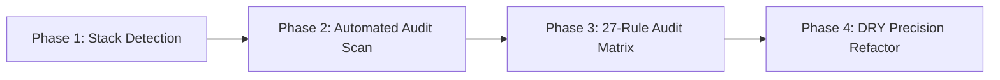

# Micro-Animations Skill Suite

[](https://github.com/enrico-07/micro-animations)
[](https://github.com/enrico-07/micro-animations)
[](https://opensource.org/licenses/MIT)
[](https://github.com/enrico-07/micro-animations)

A production-grade micro-animation engine for **Google Antigravity (AGY)**, **Claude Code**, **Cursor**, and modern web engineering teams. It systematically audits project codebases, discovers interactive elements and containers, and implements crisp, subtle, physics-based micro-interactions across **Tailwind CSS**, **React / Framer Motion**, **Vanilla CSS**, and the **Web Animations API (WAAPI)**.

Engineered around **27 core physical principles**—including Apple fluid interface foundations, Emil Kowalski tactile interactions, critically damped spring physics, and zero-layout-shift (CLS) rendering.

---

## Table of Contents

- [The 27 Core Micro-Animation Rules](#the-27-core-micro-animation-rules)
- [Architecture & The 4-Phase System](#architecture--the-4-phase-system)
- [Automated Component Scanner CLI](#automated-component-scanner-cli)
- [Shared DRY Utility Layer](#shared-dry-utility-layer)
- [How to Implement & Use This Skill](#how-to-implement--use-this-skill)
  - [1. In Google Antigravity (Global Setup)](#1-in-google-antigravity-global-setup)
  - [2. In Google Antigravity (Per-Project Setup)](#2-in-google-antigravity-per-project-setup)
  - [3. In Claude Code](#3-in-claude-code)
  - [4. In Cursor & Windsurf](#4-in-cursor--windsurf)
  - [5. In Codex & Universal AI Agents](#5-in-codex--universal-ai-agents)
- [How to Invoke in Chat](#how-to-invoke-in-chat)
- [Directory Structure](#directory-structure)
- [Initial GitHub Setup Commands](#initial-github-setup-commands)
- [Author & License](#author--license)

---

## The 27 Core Micro-Animation Rules

Every rule is calibrated with precise physical constants, timing curves, and acceleration profiles:

| # | Rule | Standard Value / Physics | Target Components |
|---|---|---|---|
| **1** | **Ease-out for entrances** | `cubic-bezier(0, 0, 0.2, 1)` | Modals, drawers, toasts, popovers |
| **2** | **Keep dropdowns at 150ms–250ms** | `180ms – 220ms` | Flyout menus, select menus, context menus |
| **3** | **Stagger list rows by 30ms** | `30ms` per item (cap 240ms) | Lists, tables, feeds, search results |
| **4** | **Scale to 0.97 on button press** | `active:scale-[0.97] duration-100` | Buttons, clickable cards, icon triggers |
| **5** | **Stretch moving knobs by 12%** | `scaleX: 1.12` during velocity | Toggle switches, slider thumbs, segment indicators |
| **6** | **Stagger when details settle** | `30ms – 40ms` child offset | Expanding accordions, card detail reveals |
| **7** | **Arcs for object movement** | Decoupled XY easing | Items moving between containers |
| **8** | **Pulse to confirm success** | `scale: [1, 1.04, 1]` over 300ms | Copy buttons, save triggers, complete chips |
| **9** | **Ease-in-out on-screen moves** | `cubic-bezier(0.4, 0, 0.2, 1)` | Active tab sliders, reordering items |
| **10**| **Start popovers at 0.95 scale** | `scale(0.95) -> scale(1.0)` | Tooltips, popovers, context menus |
| **11**| **Transition in from trigger** | `origin-top-left` / dynamic | Dropdowns, dialogs, popovers |
| **12**| **Transition out to trigger** | Collapse toward trigger origin | Dropdowns on dismiss |
| **13**| **No spring bounce for everyday UI** | Critically damped ($\zeta \ge 0.95$) | Menus, tabs, forms, buttons |
| **14**| **Exits ~20% shorter than enters** | `160ms` out vs `200ms` in | Dialogs, menus, tooltips |
| **15**| **Don't tween handheld gestures** | 1:1 pointer tracking | Swipeable cards, draggable sheets |
| **16**| **Overlap state transitions** | 30%–50% crossfade overlap | View toggles, step wizards |
| **17**| **Masks for reveals and colors** | `clip-path: inset(...)` | Content unmasking, theme transitions |
| **18**| **Crossfade icons with scale & blur**| `scale: 0.8`, `blur: 4px` | Theme toggles, copy/check, menu/X |
| **19**| **Rubberband past boundaries** | Logarithmic decay resistance | Carousels, sheets, drag limits |
| **20**| **Reuse shared layoutId** | `layoutId="active-pill"` | Active tab indicators, expanding cards |
| **21**| **Input Error Shake** | 3-cycle horizontal damped shake | Form validation errors |
| **22**| **Magnetic Cursor Gravity** | 4–6px magnetic hover pull | Primary CTAs, floating action buttons |
| **23**| **Number Ticker / Counter Roll** | Odometer roll over 380ms | Dashboard metrics, prices, counters |
| **24**| **Skeleton Shimmer Wave** | 135-degree diagonal sweep | Loading placeholders |
| **25**| **Tooltip Warm-Up & Instant Swap** | 200ms warm-up, 0ms swap | Navigation icons, action tooltips |
| **26**| **Border Beam / Glow Sweep** | 2px perimeter runner | Active highlight cards, featured plans |
| **27**| **Scroll Micro-Float** | 8px viewport entry lift | Section entries, feature cards |

---

## Architecture & The 4-Phase System

When invoked by any prompt, the skill executes a disciplined 4-phase refactoring sequence:



1. **Phase 1: Stack Detection**: Autonomously inspects `package.json`, Tailwind configs, CSS modules, and UI primitives (shadcn/ui, Radix, Headless UI, vanilla).
2. **Phase 2: Automated Audit Scan**: Scans interactive surfaces and flags missing transitions or clunky animations.
3. **Phase 3: 27-Rule Audit Matrix**: Presents a structured breakdown of candidates before applying changes.
4. **Phase 4: DRY Precision Refactor**: Upgrades root primitives and injects GPU-composited utilities (`transform`, `opacity`, `clip-path`) with zero cumulative layout shift (CLS).

---

## Automated Component Scanner CLI

This repository includes a standalone, zero-dependency Node.js scanner that you can run on any codebase:

```bash
node scripts/scan-components.mjs [path-to-project]
```

### Example Scanner Output:
```text
🔍 Scanning project for micro-animation opportunities in: ./src

📊 Scan Summary:
- Total Interactive Surfaces Found: 24
- Already Enhanced: 6
- Needs Optimization: 18

| Component File | Detected Surface | Status | Recommended Rules |
| :--- | :--- | :--- | :--- |
| `src/components/Button.tsx` | Button / Action Trigger | Needs Optimization | Rule 4 (Scale to 0.97), Rule 8 (Pulse) |
| `src/components/NavMenu.tsx` | Dropdown / Select Menu | Needs Optimization | Rule 2, Rule 10, Rule 11, Rule 14 |
| `src/components/Feed.tsx` | List / Table Feed | Needs Optimization | Rule 1 (Ease-out), Rule 3 (30ms Stagger) |
| `src/components/ThemeToggle.tsx` | Icon Toggle / Morph | Needs Optimization | Rule 18 (Scale + Blur Crossfade) |
| `src/components/LoginForm.tsx` | Form Input | Needs Optimization | Rule 21 (Input Error Shake) |
```

---

## Shared DRY Utility Layer

To prevent copying arbitrary inline strings across dozens of files, this skill provides reusable shared layers:

### 1. Tailwind CSS Plugin (`templates/tailwind.plugin.js`)
Add to your `tailwind.config.js`:
```js
module.exports = {
  plugins: [
    require('./templates/tailwind.plugin.js')
  ]
}
```
Now write clean utility classes directly in your JSX:
- `micro-press` → Applies Rule 4 (`active:scale-[0.97]`).
- `micro-popover-enter` → Applies Rule 1 & 10 (`scale(0.95) -> 1` over 200ms).
- `micro-popover-exit` → Applies Rule 14 & 12 (160ms snappy exit).
- `micro-shake` → Applies Rule 21 (240ms input error shake).
- `micro-pulse` → Applies Rule 8 (300ms success confirmation).
- `micro-float-in` → Applies Rule 27 (8px viewport entry lift).

### 2. Universal CSS Utility Layer (`templates/micro-animations.css`)
For Vanilla HTML/CSS, Vue, Svelte, or Next.js projects without Tailwind:
```html
<link rel="stylesheet" href="./templates/micro-animations.css">
```
```html
<button class="btn micro-press">Submit</button>
<div class="menu micro-popover-enter">...</div>
```

---

## How to Implement & Use This Skill

### 1. In Google Antigravity (Global Setup)
To make `/micro-animations` available globally across **every project and chat** in your Antigravity IDE:

```powershell
# 1. Clone this repository
git clone https://github.com/enrico-07/micro-animations.git
cd micro-animations

# 2. Create the global junction in your Antigravity plugins directory
New-Item -ItemType Junction -Path "$env:USERPROFILE\.gemini\config\plugins\micro-animations" -Target "$PWD"
```

*Mac/Linux equivalent:*
```bash
ln -s "$(pwd)" "$HOME/.gemini/config/plugins/micro-animations"
```

Reload your Antigravity window (`Ctrl+Shift+P` -> `Developer: Reload Window`). The skill is now active across all workspaces!

---

### 2. In Google Antigravity (Per-Project Setup)
If you prefer adding the skill strictly to an individual repository:
1. Copy the `micro-animations/` folder into your repository.
2. In your repository root, create or edit `.agents/skills.json`:
   ```json
   {
     "entries": [
       {
         "path": "micro-animations"
       }
     ]
   }
   ```

---

### 3. In Claude Code
This repository includes a pre-configured [`CLAUDE.md`](./CLAUDE.md).
1. Clone or copy `micro-animations` into your project directory.
2. When starting a Claude Code session:
   ```bash
   claude
   ```
3. Claude will automatically read `CLAUDE.md` and enforce the 27 Micro-Animation Rules during code refactors and reviews.

---

### 4. In Cursor & Windsurf
This repository includes a production-ready [`.cursorrules`](./.cursorrules).
1. Copy `.cursorrules` to your project root.
2. When asking Cursor (via `Cmd+K` or Chat):
   > *"Refactor this navigation menu and button component using our micro-animation rules."*
3. Cursor reads the rules and automatically generates the exact curves, durations, and tactile feedback.

---

### 5. In Codex & Universal AI Agents
This repository includes [`AGENTS.md`](./AGENTS.md). Any autonomous LLM coding agent (OpenAI Codex, Copilot Workspace, Aider, Devin) reading `AGENTS.md` at the project root will strictly observe zero-layout-shift constraints and the 27 motion standards.

---

## How to Invoke in Chat

Once installed, invoke the skill naturally in Antigravity or any agent chat:

```text
/micro-animations Audit and improve the button and container animations across my project.
```

Or prompt with targeted instructions:
- *"Use micro-animations to upgrade all dropdowns and popovers so they animate origin-aware from their triggers."*
- *"Run the micro-animations scanner on my components folder and propose upgrades for every button and list."*
- *"Implement the 27 micro-animation rules into my shadcn/ui button and accordion components."*
- *"Add error shake physics to my checkout form inputs and success pulse to the submit button."*

---

## Directory Structure

```text
micro-animations/
├── SKILL.md                 # Antigravity master skill specification
├── README.md                # Master documentation and installation guide
├── plugin.json              # Antigravity plugin manifest
├── CLAUDE.md                # Claude Code integration instructions
├── .cursorrules             # Cursor & Windsurf AI rule definitions
├── AGENTS.md                # Universal AI agent instructions
├── .gitignore               # Clean git exclusions
├── scripts/
│   └── scan-components.mjs  # Zero-dependency component scanner & auditor CLI
├── references/
│   ├── twenty-rules.md      # Comprehensive technical breakdown of rules 1-27
│   ├── physics-tokens.md    # Exact bezier curves, durations, and spring constants
│   └── stack-matrix.md      # Cross-stack syntax (Tailwind, Motion, CSS, WAAPI)
└── templates/
    ├── micro-animations.css # Universal drop-in CSS utility stylesheet
    ├── tailwind.plugin.js   # Tailwind CSS micro-* utility plugin
    ├── micro-button.tsx     # Rule 4 & 8: 0.97 press & success pulse
    ├── micro-dropdown.tsx   # Rule 2, 10, 11, 12, 14: Origin-aware dropdown
    ├── micro-switch.tsx     # Rule 5 & 13: 12% knob stretch & damped physics
    ├── micro-tabs.tsx       # Rule 20 & 9: Shared layoutId tab indicator
    ├── micro-list.tsx       # Rule 1 & 3: 30ms staggered list cascade
    ├── micro-icon-swap.tsx  # Rule 18 & 16: Scale + blur icon morph
    ├── micro-input-shake.tsx# Rule 21: Form input error shake
    └── micro-number-ticker.tsx # Rule 23: Odometer counter roll
```

---

## Initial GitHub Setup Commands

To push this skill repository directly to GitHub:

```powershell
# Navigate into the skill directory
cd c:\Users\ERIC\Downloads\Antigravity_Skills\micro-animations

# Initialize git repository
git init

# Stage all files
git add .

# Create the initial commit
git commit -m "feat: initial commit for micro-animations skill suite with 27 rules, scanner CLI, and multi-agent presets"

# Rename default branch to main
git branch -M main

# Link to your remote GitHub repository
git remote add origin https://github.com/enrico-07/micro-animations.git

# Push to GitHub
git push -u origin main
```

---

## Author & License

- **Author**: Enrico ([@enrico-07](https://github.com/enrico-07))
- **Repository**: [https://github.com/enrico-07/micro-animations](https://github.com/enrico-07/micro-animations)
- **License**: MIT
