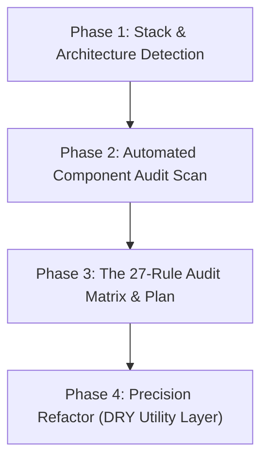

# Micro-Animations Skill Suite

The **Micro-Animations** skill delivers crisp, subtle, physics-based motion to web interfaces. It systematically eliminates clunky, sluggish, or missing transitions, replacing them with natural, responsive micro-interactions that elevate software into a tier-1, satisfying experience.

---

## The 4-Phase Execution Workflow

When invoked (e.g. *"Audit and add micro-animations to my project"* or *"Improve the button and container animations"*), follow this exact four-phase sequence:



### Phase 1: Stack & Architecture Detection
Automatically inspect project configuration files:
1. **Package manifest**: `package.json` (check for `tailwindcss`, `framer-motion`, `motion`, `@radix-ui/*`, `lucide-react`, `vue`, `svelte`).
2. **Style setup**: `tailwind.config.*`, CSS Modules (`*.module.css`), or global CSS files.
3. **Framework**: React / Next.js, Vue / Nuxt, Svelte, or Vanilla HTML/CSS/JS.

---

### Phase 2: Automated Component Audit Scan
Use the built-in scanner `scripts/scan-components.mjs` or perform an AST scan across the repository:
- **Buttons & Clickable Elements**: `<button>`, `<a>`, `<Link>`, tab triggers, icon actions.
- **Dropdowns, Popovers & Menus**: Select menus, profile flyouts, context menus, tooltips.
- **Lists & Data Tables**: `<ul>`, `<ol>`, table rows, card grids, search results.
- **Containers & Accordions**: Expanding panels, disclosure widgets, collapsible sidebars.
- **Toggles & Knobs**: Switches, range sliders, segment controls.
- **Icons**: State toggles (Dark/Light, Copy/Check, Menu/Close, Play/Pause).
- **Form Inputs**: Text inputs, search bars, validation containers.
- **Navigation & Tabs**: Tab bars, segmented controls, breadcrumbs.

---

### Phase 3: The 27-Rule Audit Matrix & Plan
Present an interactive or structured summary table to the user before editing code:

```markdown
| Component File | Interactive Element | Current State | Applicable Rules | Proposed Upgrade |
| :--- | :--- | :--- | :--- | :--- |
| `src/components/Button.tsx` | Primary CTA | Raw hover color only | Rule 4, Rule 8 | Add `active:scale-[0.97]` + 300ms success pulse |
| `src/components/NavMenu.tsx` | Dropdown flyout | Sluggish 400ms fade | Rule 2, 10, 11, 14 | 200ms entrance, scale from 0.95, origin-top-right, 160ms exit |
| `src/components/Feed.tsx` | Post list | Instant simultaneous pop | Rule 1, Rule 3 | Stagger rows by 30ms with `ease-out` entrance |
| `src/components/ThemeToggle.tsx`| Sun/Moon Icon | Hard swap | Rule 18 | Scale + blur crossfade (0.8 <-> 1, 4px blur) |
| `src/components/LoginForm.tsx` | Auth Inputs | Generic red text | Rule 21 | Add 240ms 3-cycle horizontal damped error shake |
```

---

### Phase 4: Precision Refactor (DRY Utility Layer)
To maximize code reusability without polluting every single JSX node:
1. **Shared Utility Layer**:
   - For Tailwind projects: Inject `templates/tailwind.plugin.js` or add `@utility micro-press`, `@utility micro-popover-enter` into `globals.css`.
   - For Vanilla/CSS projects: Import `templates/micro-animations.css`.
2. **Root Primitive Enhancement**:
   - Enhance the root primitive (e.g. `components/ui/button.tsx`, `components/ui/dropdown-menu.tsx`) so **every instance in the application inherits the physics automatically**.
3. **Hardware Acceleration & CLS Zero Shift**:
   - Strictly animate `transform`, `opacity`, and `clip-path`. Never animate `width`, `height`, `margin`, or `top`.
4. **Accessibility Compliance**:
   - Enforce `@media (prefers-reduced-motion: reduce)` fallback across all animated components.

---

## The 27 Core Micro-Animation Rules

### Group A: Tactile Feedback & Buttons
- **Rule 4: Scale to 0.97 on Press** (`active:scale-[0.97] duration-100 ease-out`). Physical gold standard.
- **Rule 8: Pulse to Confirm Success** (`scale: [1, 1.04, 1]`, duration: 300ms). Gentle micro-pulse.
- **Rule 22: Magnetic Cursor Gravity** (Pull 4–6px toward cursor within 12px hover zone, snap back on leave).

### Group B: Popovers, Menus & Dropdowns
- **Rule 2: Dropdowns at 150ms–250ms** (Sweet spot: 180–220ms).
- **Rule 10: Start Popovers at 0.95 Scale** (Never scale from 0).
- **Rule 11: Transition In From Trigger** (Anchor `transform-origin` to trigger position).
- **Rule 12: Transition Out Toward Trigger** (Collapse back toward trigger).
- **Rule 14: Exits ~20% Shorter Than Entrances** (Entrance: 200ms `ease-out`, Exit: 160ms `ease-in`).
- **Rule 25: Tooltip Warm-Up & Instant Swap** (200ms initial warm-up, 0ms swap between siblings).

### Group C: Lists, Feeds & Data Tables
- **Rule 1: Ease-Out for Entrances** (`cubic-bezier(0, 0, 0.2, 1)`).
- **Rule 3: Stagger List Rows by 30ms** (Cap total cascade at 240ms).
- **Rule 16: Overlap State Transitions** (Overlap exit and entrance by 30–50%).
- **Rule 27: Scroll Micro-Float** (Gentle 8px Y-axis lift on entering viewport).

### Group D: Toggles, Controls & Sliders
- **Rule 5: Stretch Moving Knobs by 12%** (`scaleX: 1.12` along movement axis).
- **Rule 13: No Spring Bounce for Everyday UI** (Critically damped $\zeta \ge 0.95$).
- **Rule 15: Don't Tween Handheld Gestures** (Direct pointer tracking 1:1; tween only on release).
- **Rule 19: Rubberband Past Drag Boundaries** (Logarithmic resistance decay $dx = \text{offset} \times 0.25$).

### Group E: Containers, Reveals & Layouts
- **Rule 6: Stagger When Details Settle** (Animate outer bounds first, settle child details 30ms later).
- **Rule 7: Arcs for Object Movement** (Decoupled X and Y timing curves).
- **Rule 9: Ease-In-Out for On-Screen Moves** (`cubic-bezier(0.4, 0, 0.2, 1)`).
- **Rule 17: Masks for Reveals and Colors** (`clip-path: inset(...)` for zero layout shift).
- **Rule 20: Reuse layoutId Across Shared Objects** (`layoutId` or CSS View Transitions).
- **Rule 26: Border Beam / Glow Sweep** (2px perimeter beam on active highlight cards).

### Group F: Forms, Icons & Metrics
- **Rule 18: Crossfade Icons with Scale & Blur** (Simultaneous opacity, scale `1 ↔ 0.8`, blur `0px ↔ 4px`).
- **Rule 21: Input Error Shake** (3-cycle damped horizontal shake over 240ms on invalid input).
- **Rule 23: Number Ticker / Counter Roll** (Odometer roll with deceleration over 380ms).
- **Rule 24: Skeleton Shimmer Wave** (135-degree diagonal sweep over 1200ms).

---

## Accessibility & Reduced Motion

Always respect user accessibility preferences. When `prefers-reduced-motion` is enabled:
```css
@media (prefers-reduced-motion: reduce) {
  *, *::before, *::after {
    animation-duration: 0.01ms !important;
    animation-iteration-count: 1 !important;
    transition-duration: 0.01ms !important;
    scroll-behavior: auto !important;
  }
}
```
Or in Tailwind: `motion-reduce:transition-none motion-reduce:transform-none`.
